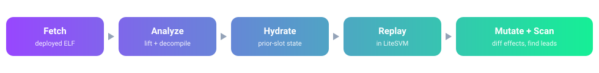
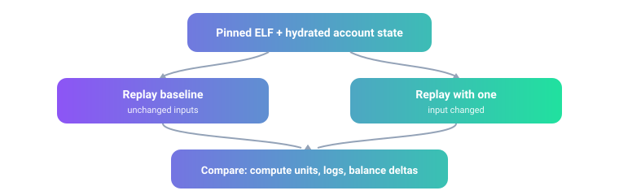

# soldecomp

**Reverse-engineer, replay, and probe already-deployed Solana programs on your own machine, from bytecode, with no live-chain writes.**

<p align="center">
  
</p>

A Solana program ships on-chain as compiled sBPF bytecode with no source. soldecomp fetches that bytecode, lifts and decompiles it, and re-runs a real past transaction locally so you can watch what the program did, change one input, and compare the result. The Python CLI uses only the standard library; Ghidra, Solana platform tools, and an archive RPC are optional, per command.

> **Status: released as-is, no longer maintained.** This is a research workbench for defensive analysis of already-deployed, public bytecode. Every detector output is a lead to verify by hand, not proof of a reachable or profitable bug. It is not an exploit kit.

## What it does

- **Analyze** any deployed ELF: register-level lift, call graph, strings, sBPF ISA version, resolved syscalls.
- **Decompile** to Ghidra C-like pseudocode with Solana syscall signatures and input-account field labels.
- **Detect** framework (Anchor, Pinocchio, native), crate versions, toolchain, and instruction interface without running it.
- **Replay** a pinned instruction or a full historical transaction in a patched LiteSVM, hydrating prior-slot accounts and sysvars from an archive RPC.
- **Probe** by changing one input at a time and diffing compute units, logs, and account effects.
- **Scan** for five common bug classes against a labeled corpus that reports real precision and recall.
- **Rebuild** candidate Rust with a pinned Solana toolchain and gate it on a byte and score diff.

## How replay works

<p align="center">
  
</p>

Pin the deployed ELF and the account state as of a transaction's slot, run it unchanged, then run it again with exactly one input changed. Comparing the two runs is how you test a hypothesis such as "does this program's price trust a balance it should not?" without touching the live chain.

## Install

```sh
git clone https://github.com/aaronjmars/soldecomp.git
cd soldecomp
cargo build --locked --manifest-path replay/Cargo.toml
```

Python 3.12 and Rust 1.99.1 cover the offline analyzer, the pinned benchmark, and the replay runner. The LiteSVM patch and its lockfile are vendored. Headless Ghidra (`decompile`), Solana platform tools (`build`), and an archive-capable RPC (historical `hydrate`) are optional.

## Quickstart

```sh
# Offline, no RPC: run the pinned cross-program benchmark
python3 soldecomp.py benchmark benchmarks/manifest.json --out out/benchmark

# Score the generic bug detectors against the labeled corpus
python3 soldecomp.py corpus-benchmark benchmarks/corpus/manifest.json --out out/corpus

# Inspect a live program
python3 soldecomp.py fetch PROGRAM_ID --out samples/program.so
python3 soldecomp.py analyze samples/program.so --out out/program
python3 soldecomp.py detect-framework samples/program.so
```

For historical replay, set an archive RPC and read its key inline; never commit it:

```sh
export SOLDECOMP_ARCHIVE_RPC="https://your-archive-rpc/..."
python3 soldecomp.py capture SIGNATURE --elf samples/program.so --instruction-index 0 --out out/f.json
python3 soldecomp.py hydrate out/f.json --out out/f-pre-slot.json
python3 soldecomp.py replay out/f-pre-slot.json --out out/replay.json
```

`hydrate` needs historical account state, not just archived transactions: the RPC must accept a `slot` param on `getAccountInfo` and answer with `context.slot` equal to that slot (anything else is rejected). Tested with Alchemy Solana mainnet (`https://solana-mainnet.g.alchemy.com/v2/<key>`):

```text
{"method":"getAccountInfo","params":["11111111111111111111111111111111",{"slot":459000000,"encoding":"base64","commitment":"finalized"}]}
→ {"result":{"context":{"apiVersion":"4.1.0","slot":459000000},"value":{...}}}
```

## Commands

| Group | Commands |
| --- | --- |
| Inspect bytecode | `fetch` `analyze` `decompile` `detect-framework` `trace` `inspect` `discover-fields` `packet` |
| Replay + historical state | `capture` `hydrate` `reconstruct-slot` `audit-slot` `replay` `archive-simulate` `apply-state` `reconcile` `runtime-audit` `trace-exec` `trace-roles` |
| Probe + find bugs | `scan` `probe` `probe-donation` `bug-checks` |
| Benchmarks | `benchmark` `corpus-benchmark` `blind-benchmark` `score-blind` |
| Rebuild source | `build` `compare` `judge` |

Run any command with `-h` for its options.

## Benchmarks

The pinned, offline benchmark covers Memo, SPL Token, Token-2022, an oracle updater, Jupiter and GoonFi routes, and source-built control pairs; it runs with no RPC. `corpus-benchmark` scores the five framework-agnostic `scan` detectors against a labeled corpus: currently precision 0.83 and recall 1.0 over 13 verdicts.

Honest caveat: the corpus is mostly synthetic controls plus clean deployed programs, with one deployed known-bug positive (the historical GoonFi ELF). `field_accuracy_measurable` stays `false` until at least five deployed known-bug positives are scored, so these numbers verify detector wiring, not field accuracy. See [NEXT.md](NEXT.md).

## Limitations

- Not automatic Rust source recovery. Ghidra output needs human review and can miss function boundaries; byte-identical compilation is the only conclusive build match.
- Replay reconstructs behavior from captured state; it is not an exact on-chain execution trace. Check `origin.state_exact`, `program_version_verified`, and `limitations` in each fixture.
- Detector findings are hypotheses; absence of a finding is not a safety proof.

## License and third-party code

MIT, see [LICENSE](LICENSE). This repository vendors a modified copy of [LiteSVM](https://github.com/LiteSVM/litesvm) 0.12.0 under `replay/vendor/litesvm-0.12.0/`; LiteSVM is Apache-2.0 and that directory keeps its own `LICENSE` and a `CHANGES.md` for the two added methods, staying under Apache-2.0. The optional [SolEmu-Ghidra](https://github.com/samsheff/SolEmu-Ghidra) processor is a separate Apache-2.0 project fetched at setup and not included here. Benchmark `.so` files are either compiled from the source controls in this repository or public, already-deployed on-chain bytecode.
